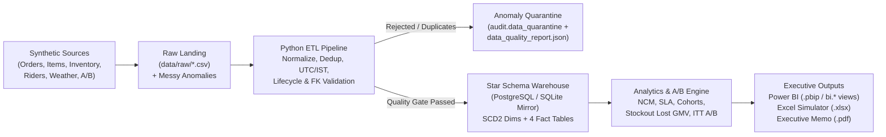
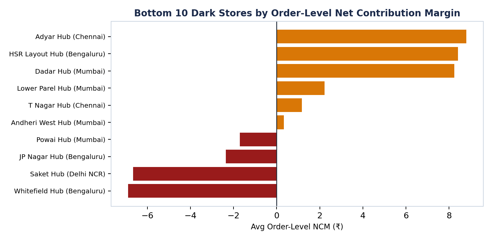

# QuickCommerceIQ — Dark Store Operations, Delivery SLA & Unit Economics Analytics Platform

[](https://www.python.org/)
[](https://www.postgresql.org/)
[](dashboard/QuickCommerceIQ.pbip)
[](tests/)

> **Synthetic Data Disclaimer:** All operational, customer, inventory, weather, and financial records in **QuickCommerceIQ** are **synthetically and reproducibly generated (`seed=42`)** to model an Indian quick-commerce operator. Simulated metrics must never be presented as actual financials of any real company.

---

## 1. What QuickCommerceIQ Does & Business Problem

**QuickCommerceIQ** is an end-to-end **Data Engineering, Analytics Engineering, Statistical Experimentation, and Business Intelligence** platform modeled on high-frequency Indian quick-commerce operations (Blinkit / Zepto / Swiggy Instamart scale).

### The Core Problem
Across a 6-month operating window (**May–October 2026**) spanning **25 dark stores** in **4 Indian metros** (**Bengaluru [7], Mumbai [7], Delhi NCR [6], Chennai [5]**):
- Order volume grew **~28% quarter-on-quarter**, yet **Net Contribution Margin (NCM) per order deteriorated from +₹19.48 (May 2026) to -₹3.27 (October 2026)**.
- **49.86%** of delivered orders breached the **12-minute Delivery SLA**, peaking at **75.16%** during 9 PM IST and **98.46%** during heavy rain.

Leadership needs a single decision-support warehouse and analytics system to answer:
1. Which dark stores are losing money (before and after fixed store rent & utilities)?
2. Which hourly windows and operational stages (`PICKING`, `RIDER_ASSIGNMENT`, `TRANSIT`) cause SLA breaches?
3. How much GMV and margin are lost to 7 PM–10 PM SKU stockouts?
4. How severely does heavy rain inflate rider costs and delivery times?
5. How does first-order delivery speed affect Month 0–6 customer retention?
6. Does raising the free-delivery threshold from **₹199 to ₹249** improve **Net Profit per Randomized User (NPPU)** without breaking retention or cart-abandonment guardrails?

All financial figures use **INR (₹)** with **Indian number formatting** (`₹ Lakhs`, `₹ Crores`), **UTC warehouse storage**, and **`Asia/Kolkata` (IST)** reporting timestamps.

---

## 2. Technology Stack

| Layer | Technologies |
|---|---|
| **Warehouse & SQL** | PostgreSQL 16 (`dw`, `stg`, `audit`, `bi` schemas), Star Schema, SCD Type 2, Window Functions (`LAG`, `RANK`, `LEAD`, rolling `RANGE INTERVAL`), SQLite 3 local mirror (`python/db.py`) |
| **ETL & Data Quality** | Python 3.12, Pandas, NumPy, SQLAlchemy 2.0, Psycopg 3, PyYAML, `QuarantineManager`, critical JSON quality gates |
| **Statistical Testing** | SciPy (`ttest_ind`, `mannwhitneyu`, `chisquare`, `norm`), Two-Proportion Z-Tests, Sample-Size Power Analysis, 2,000-resample Bootstrap CIs |
| **Financial Modeling** | `openpyxl` 4-sheet workbook with dynamic Excel formulas, Indian currency formatting, data validation, and conditional formatting |
| **Business Intelligence** | Power BI Project (`QuickCommerceIQ.pbip` with TMDL Semantic Model & PBIR 3-page Report), PostgreSQL `bi.*` views, DAX measures |
| **Reporting & Testing** | Matplotlib, ReportLab (`reports/executive_memo.pdf`), `pytest` (16 automated unit & integration tests) |

---

## 3. End-to-End Architecture



See [docs/architecture.md](docs/architecture.md) for the detailed architecture and configurable batch refresh cadence (`1-min` orders/riders, `15-min` inventory, `30-min` weather, `hourly` financials, `daily` cohorts & A/B readouts).

---

## 4. Dataset Characteristics & Data Quality Audit

The synthetic generator (`python/generators/generate_all.py`, `seed=42`) produces **11 raw CSV datasets** (plus SCD Type 2 history files and 100-row previews in `data/sample/`) and deliberately injects **12 realistic messy data anomalies** (duplicate webhooks/notifications, city spelling typos, malformed pincodes, mixed UTC/IST timestamps, negative prices/inventory, missing riders on delivered orders, invalid lifecycle timestamps, invalid SKU FKs, and inconsistent payment labels).

| Dataset | Raw Rows | Accepted / Loaded | Quarantined / Rejected | Notes |
|---|---:|---:|---:|---|
| `dark_stores.csv` | 26 | **25** (30 SCD2 rows) | 1 | Quarantined `STR-999` (`INVALID_INDIAN_PINCODE`); normalized `Bangalore`, `Bombay`, `New Delhi`, `Madras` |
| `customers.csv` | 42,000 | **42,000** | 0 | City spelling variants standardized to canonical metros |
| `riders.csv` | 600 | **600** | 0 | Distributed across 25 stores (`EV_SCOOTER`, `PETROL_BIKE`, `BICYCLE`) |
| `skus.csv` | 650 | **650** (715 SCD2 rows) | 0 | 8 grocery categories; ~10% have mid-period SCD2 price/cost revisions |
| `orders.csv` | 179,887 | **174,288** | 5,599 | 3,526 duplicates + 2,073 validation failures (`6,803` cancelled orders preserved with `NULL` `delivered_at`) |
| `order_items.csv` | 468,730 | **460,458** | 8,272 | 1,406 negative price/cost/qty + 1,398 invalid SKUs + 5,468 orphan order refs |
| `inventory_snapshots.csv` | 1,177,600 | **1,168,180** | 9,420 | Quarantined 9,420 negative inventory glitches |
| `weather_data.csv` | 35,328 | **35,328** | 0 | 30-min slots across 4 metros (`NORMAL`, `MONSOON`, `HEAVY_RAIN`) |
| `rider_logs.csv` | 508,674 | **493,267** | — | `ASSIGNED`, `PICKED_UP`, `DELIVERED` events filtered to accepted orders |
| `ab_experiment_assignments.csv` | 42,000 | **42,000** | 0 | Deterministic SHA-256 50/50 customer split |
| `ab_experiment_events.csv` | 75,419 | **74,475** | — | Checkout & cart abandonment events (`2026-09-01` to `2026-10-31`) |

Full reconciliation and gate status are persisted in [reports/data_quality_report.json](reports/data_quality_report.json) (`3.11%` order rejection/dup rate, all 7 critical gates `true`).

---

## 5. Database Schema (Star Schema + SCD Type 2)

Implemented in [sql/ddl/01_init_warehouse.sql](sql/ddl/01_init_warehouse.sql), [sql/ddl/02_staging_and_audit.sql](sql/ddl/02_staging_and_audit.sql), and [sql/ddl/03_indexes_and_constraints.sql](sql/ddl/03_indexes_and_constraints.sql):

- **Dimensions (`dw.*`):**
  - `dim_dark_stores` *(SCD Type 2)* — `store_sk`, `store_id`, `city`, `pincode`, `rent_tier`, `monthly_rent`, `staffing_level`, `effective_from`, `effective_to`, `is_current`
  - `dim_skus` *(SCD Type 2)* — `sku_sk`, `sku_id`, `category`, `unit_cost`, `selling_price`, `gross_margin`, `effective_from`, `effective_to`, `is_current`
  - `dim_customers`, `dim_riders`, `dim_date_time` (hourly IST grain `YYYYMMDDHH`)
- **Facts (`dw.*`):**
  - `fact_orders` (1 row per order)
  - `fact_order_items` (1 row per order-SKU, FK to `fact_orders`, preserves `historical_unit_price` and `historical_unit_cost`)
  - `fact_inventory_snapshots` (1 row per store-SKU-timestamp)
  - `fact_ab_experiment_events` (1 row per customer experiment event)
- **Supporting & Audit:** `ab_experiment_assignments`, `fact_weather_observations`, `fact_rider_logs`, `stg.raw_*`, `audit.etl_batch_runs`, `audit.data_quarantine`.

See [docs/data_dictionary.md](docs/data_dictionary.md) for full column-level specifications.

---

## 6. Key Analytics & Observed Results

All metrics below are computed directly from the loaded warehouse ([analytics_summary.json](reports/analytics_summary.json)):

### A. Unit Economics & Net Contribution Margin (`sql/analytics/01_unit_economics.sql`)
$$\text{NCM} = \text{Gross Margin} + \text{Handling Fee} + \text{Delivery Fee} + \text{Surge Fee} - \text{Discounts} - \text{Rider Payout} - \text{Packaging Cost} - \text{Refund Cost}$$
- **6-Month Total GMV:** **₹4.65 Crore** (`₹46,493,962.99`) across **174,288 accepted orders** (`167,485` delivered).
- **Order-Level NCM:** **₹11.18 Lakhs** total (**₹6.42/order** average), dropping from **+₹19.48/order (May 2026)** to **-₹3.27/order (October 2026)**.
- **Store Bleeding vs Fixed Costs:** **4 stores** lose money at the order-contribution level (`STR-005 Whitefield Hub -₹6.89`, `STR-016 Saket Hub -₹6.66`, `STR-003 JP Nagar Hub -₹2.36`, `STR-013 Powai Hub -₹1.71`), while **all 25 stores** are net-negative over 6 months once fixed rent and utilities (`1.15× monthly_rent`) are included.

### B. Delivery SLA Decomposition & Weather Impact (`sql/analytics/02_sla_and_bottlenecks.sql`)
- **Delivery Time:** Mean **12.47 min** (P50 `12.00m`, P90 `18.25m`, P95 `20.27m`); **49.86%** SLA breach rate (>12 min).
- **Stage Breakdown:** Picking **3.28m** + Rider Assignment **2.81m** + Transit **6.38m**.
- **Peak & Weather Stress:** Hour `21` (9 PM IST) peaks at **75.16%** SLA breaches; **Heavy Rain** pushes SLA breaches from **36.42% (Normal)** to **98.46%**.

### C. Customer Cohort Retention (`sql/analytics/03_cohort_retention.sql`)
- Evaluated strictly on delivered orders segmented by first-order SLA (`FAST <12m`, `MEDIUM 12–20m`, `SLOW >20m`).
- Month 1 retention: **51.83%** (`FAST <12m`) vs **50.18%** (`SLOW >20m`).

### D. Peak-Hour (7–10 PM) Stockout Lost GMV (`sql/analytics/04_stockout_lost_gmv.sql`)
- Uses non-overlapping `LEAD()` snapshot intervals capped at 15 minutes and counterfactual comparable weekday/hour in-stock demand rates (with 25% substitution adjustment).
- Across 16 tracked hero SKUs: **17,469.50 peak stockout hours** → **813.06 estimated lost units**, **₹64,450.87 estimated lost GMV**, and **₹15,545.82 estimated lost margin**.

---

## 7. A/B Experiment Methodology & Results

Evaluated via **Intention-to-Treat (ITT)** over `2026-09-01` to `2026-10-31` across all **42,000** deterministically randomized customers (`python/experiments/ab_testing.py`, [docs/ab_test_methodology.md](docs/ab_test_methodology.md)):

| Metric / Check | Control (₹199) | Treatment (₹249) | Lift / Result | Statistical Test & Significance |
|---|---:|---:|---:|---|
| **Sample Split / SRM** | 21,122 users | 20,878 users | 50.3% / 49.7% | Chi-Square `χ² = 1.4175`, `p = 0.2338` (**PASS**) |
| **NPPU (Primary, ₹/user)** | -₹4.87 | +₹0.85 | **+₹5.72 / user** | Welch `t = 15.39`, `p < 0.0001`; Bootstrap 95% CI `[₹4.98, ₹6.49]` |
| **Conversion Rate (ITT)** | 67.92% | 67.33% | -0.59 pp | Two-Prop Z-Test `p = 0.1960` (NS) |
| **AOV (Delivered, ₹)** | ₹265.04 | ₹273.30 | **+₹8.26** | Welch `t = 8.59`, `p < 0.0001` |
| **Cart Abandonment (Guardrail)** | 8.69% | 11.00% | +2.32 pp | Two-Prop Z-Test `p < 0.0001` (within `+3.50 pp` cap) |
| **30-Day Repeat Rate (Guardrail)** | 61.34% | 59.37% | **-1.97 pp** | Two-Prop Z-Test `p = 0.0047` (**breached `-1.50 pp` floor**) |

**Final Recommendation:** **`TARGETED_ROLLOUT_OR_229_TEST`** — avoid a blanket network-wide jump to ₹249 due to repeat-rate erosion; pilot an intermediate **₹229** threshold or restrict ₹249 to high-density hubs.

---

## 8. Power BI Dashboard & Excel Simulator

### Power BI (`dashboard/`)
- **Power BI Project:** [dashboard/QuickCommerceIQ.pbip](dashboard/QuickCommerceIQ.pbip) with TMDL Semantic Model (`QuickCommerceIQ.SemanticModel`) and 3-page PBIR Report (`QuickCommerceIQ.Report`: **Executive Landing**, **Operations & SLA Deep-Dive**, **Growth, Cohorts & AB Test**), styled via [dashboard/QuickCommerceIQ_Theme.json](dashboard/QuickCommerceIQ_Theme.json).
- **PostgreSQL BI Views & DAX:** [sql/analytics/powerbi_views.sql](sql/analytics/powerbi_views.sql), [dashboard/dax_measures.md](dashboard/dax_measures.md), and [dashboard/dashboard_documentation.md](dashboard/dashboard_documentation.md).

### Excel Unit Economics Simulator (`excel_models/`)
- [excel_models/QuickCommerceIQ_Unit_Economics_Simulator.xlsx](excel_models/QuickCommerceIQ_Unit_Economics_Simulator.xlsx) containing 4 formula-driven worksheets:
  1. `Inputs` (with Excel data validation dropdowns & non-negative constraints)
  2. `Unit_Economics` (Normal vs Monsoon & ₹199 vs ₹249 scenarios + fixed-cost store profit)
  3. `BreakEven_Model` (order contribution break-even AOV vs fixed-cost-inclusive store break-even AOV)
  4. `Sensitivity_Analysis` (2-variable dynamic formula grids across AOV `₹149–₹399` and Rider Payout `₹20–₹50` with Red/Green conditional formatting)

---

## 9. Executive Charts (`reports/figures/`)




See [reports/executive_memo.pdf](reports/executive_memo.pdf) and [docs/executive_summary.md](docs/executive_summary.md) for the full leadership readout.

---

## 10. Repository Structure

```text
QuickcommerceIQ/
├── run_pipeline.py                    # End-to-end pipeline orchestrator
├── docker-compose.yml                 # Local PostgreSQL 16 container setup
├── requirements.txt                   # Pinned Python dependencies
├── .env.example                       # Environment variable template
├── PROJECT_STATUS.md                  # Phase tracker & environment notes
├── config/                            # settings.yaml, city_mapping.json, simulation_config.yaml
├── data/                              # raw/, staging/, processed/ (+ SQLite DB), sample/
├── sql/
│   ├── ddl/                           # Star schema, staging/audit, indexes
│   ├── transformations/               # SCD2 upsert templates
│   └── analytics/                     # Core analytical SQL & Power BI bi.* views
├── python/
│   ├── generators/                    # Master data, orders, telemetry, messy data injection
│   ├── cleaning/                      # Text, city, payment, UTC/IST, deduplication
│   ├── ingestion/                     # Transactional ETL & SCD2 surrogate key loader
│   ├── analytics/                     # Engine, Excel simulator, PBIP builder, PDF memo
│   └── experiments/                   # Statistical A/B testing framework
├── data_quality/                      # validation_rules.yaml, quality_checks.py, quarantine.py
├── excel_models/                      # QuickCommerceIQ_Unit_Economics_Simulator.xlsx
├── dashboard/                         # QuickCommerceIQ.pbip (+ SemanticModel/Report), DAX, docs
├── tests/                             # pytest suite (16 automated tests)
├── docs/                              # Architecture, data dictionary, metrics, A/B & exec docs
└── reports/                           # JSON reports, experiment_results.csv, PDF memo, PNG charts
```

---

## 11. Installation & Local Execution (Windows 11)

### Step 1: Clone & Install Dependencies
```powershell
python -m pip install -r requirements.txt
Copy-Item .env.example .env
```

### Step 2: Configure Database (PostgreSQL or Zero-Setup Local SQLite Mirror)
- **Option A — PostgreSQL via Docker Compose:**
  ```powershell
  docker compose up -d
  ```
- **Option B — Zero-Setup Local Mode:** Keep default `.env` or set `DB_BACKEND=sqlite`. `python/db.py` automatically falls back to the schema-aligned SQLite warehouse at `data/processed/quickcommerce_warehouse.db` if PostgreSQL is unreachable.

### Step 3: Run Full Pipeline End-to-End
```powershell
python run_pipeline.py
```
Or run individual stages step by step:
```powershell
python -m python.generators.generate_all
python -m python.ingestion.etl_pipeline
python -m python.analytics.engine
python -m python.experiments.ab_testing
python -m python.analytics.excel_simulator
python -m python.analytics.executive_report
python -m python.analytics.powerbi_pbip_builder
```

### Step 4: Run Automated Tests
```powershell
python -m pytest -v
```

### Step 5: Open Deliverables
- **Power BI Desktop:** Open `dashboard/QuickCommerceIQ.pbip` (or connect PostgreSQL `bi.*` views via `sql/analytics/powerbi_views.sql`).
- **Excel Simulator:** Open `excel_models/QuickCommerceIQ_Unit_Economics_Simulator.xlsx`.
- **Executive Memo:** Open `reports/executive_memo.pdf`.

---

## 12. Limitations & Assumptions

- **Synthetic Data Scope:** All demand curves, weather disruptions, rider payouts, and A/B customer responses are simulated (`seed=42`) to reproduce realistic quick-commerce unit-economics dynamics.
- **Local PostgreSQL Fallback:** When PostgreSQL/Docker is unavailable on the local Windows machine, `python/db.py` executes against the local SQLite mirror (`data/processed/quickcommerce_warehouse.db`), while `sql/ddl/*.sql` and `sql/analytics/*.sql` remain native PostgreSQL scripts.
- **Power BI Project (`.pbip`) Format:** `dashboard/QuickCommerceIQ.pbip` uses TMDL + PBIR connected to `data/processed/*.csv` and `reports/experiment_results.csv`; click **Refresh** in Power BI Desktop upon opening to load the CSVs into memory, or switch sources to PostgreSQL `bi.*` views using [dashboard/dashboard_documentation.md](dashboard/dashboard_documentation.md).
- **Stockout & Fixed-Cost Modeling:** Evening stockout analysis tracks 16 high-velocity hero SKUs across all 25 dark stores assuming 25% customer substitution elasticity; fixed store overhead applies a `1.15×` multiplier on `monthly_rent` for electricity and cold-chain utilities.
