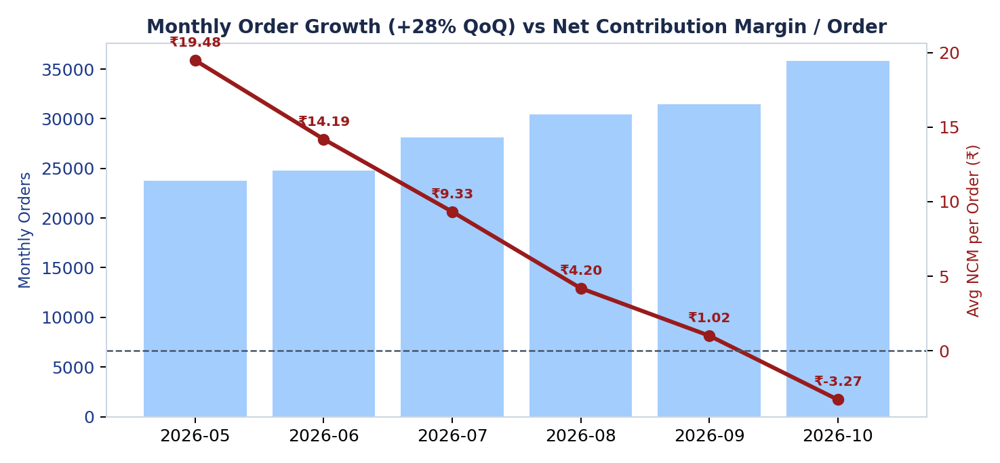
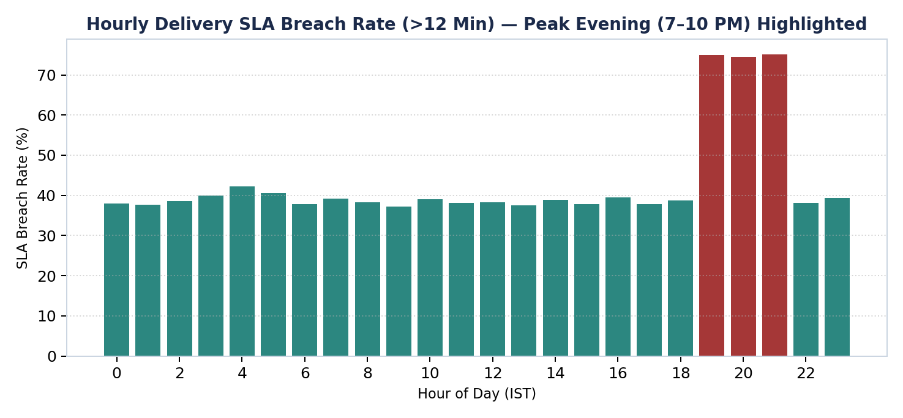

# QuickCommerceIQ — Dark Store Operations, Delivery SLA & Unit Economics Analytics Platform

> **Synthetic Data Notice:** All operational, customer, inventory, and financial datasets in this repository are **synthetically and reproducibly generated (`seed=42`)** to model an Indian quick-commerce operator. They must not be represented as actual financial performance of any real company.

---

## 1. Overview & Business Problem

**QuickCommerceIQ** is an end-to-end Data Engineering, Analytics Engineering, Data Science, and BI platform built to diagnose why **+28% quarter-on-quarter order growth** across **25 dark stores** in **4 Indian metropolitan regions** (Bengaluru, Mumbai, Delhi NCR, Chennai) coincided with **Net Contribution Margin (NCM) deteriorating from +₹19.48/order (May 2026) to -₹3.27/order (October 2026)**.

All financial models operate in **INR (₹)** using **Indian numbering formatting** (`₹ Lakhs`, `₹ Crores`), **Asia/Kolkata (IST)** reporting timestamps, and a **12-minute Delivery SLA**.

---

## 2. Architecture & Technology Stack

- **Database & Warehouse:** PostgreSQL 16 (Star Schema with SCD Type 2 `dim_dark_stores` & `dim_skus`, staging, audit, and quarantine schemas; plus a schema-aligned local SQLite mirror in `python/db.py` when Postgres is not running locally).
- **ETL & Data Quality:** Python 3.12, Pandas, NumPy, SQLAlchemy, Psycopg 3, PyYAML, automated critical quality gates, and JSON audit reports (`reports/data_quality_report.json`).
- **Statistical Experimentation:** SciPy (`ttest_ind`, `mannwhitneyu`, `chisquare`), Two-Proportion Z-Tests, power analysis, and 2,000-resample Bootstrap confidence intervals.
- **Financial Modeling & BI:** `openpyxl` dynamic Excel simulator (`excel_models/QuickCommerceIQ_Unit_Economics_Simulator.xlsx`), PostgreSQL `bi.*` Power BI views (`sql/analytics/powerbi_views.sql`), DAX measures (`dashboard/dax_measures.md`), Matplotlib charts, and ReportLab executive memo (`reports/executive_memo.pdf`).

See [docs/architecture.md](docs/architecture.md) for the full Mermaid architecture diagram and refresh cadence specification.

---

## 3. Dataset Scale & Data Quality Audit

| Entity / Dataset | Raw Rows | Accepted / Loaded | Quarantined / Dropped |
|---|---:|---:|---:|
| Dark Stores | 26 | 25 stores (30 SCD2 rows) | 1 invalid Indian pincode (`STR-999`) |
| Customers | 42,000 | 42,000 | City typos normalized (`Bangalore` → `Bengaluru`, etc.) |
| Riders | 600 | 600 | — |
| SKUs | 650 | 650 (715 SCD2 rows) | — |
| Orders | 179,887 | **174,288** (167,485 delivered) | 3,526 duplicates + 2,073 invalid/lifecycle/negative |
| Order Items | 468,730 | 460,458 | 8,272 negative/invalid SKU/orphan refs |
| Inventory Snapshots | 1,177,600 | 1,168,180 | 9,420 negative inventory glitches |
| Weather Observations | 35,328 | 35,328 | — |
| Rider Activity Logs | 508,674 | 493,267 | Filtered to accepted orders |
| A/B Assignments & Events | 42,000 / 75,419 | 42,000 / 74,475 | — |

---

## 4. Key Analytical Findings (Observed Outputs)

1. **Unit Economics (`sql/analytics/01_unit_economics.sql`):**
   - 6-Month Total GMV: **₹4.65 Crore** (`₹46,493,962.99`); Total Order-Level NCM: **₹11.18 Lakhs** (`₹6.42/order`).
   - Monthly NCM fell from **+₹19.48/order (May)** to **-₹3.27/order (October)**.
   - **4 stores** lose money at order-level NCM (`STR-005 Whitefield Hub -₹6.89`, `STR-016 Saket Hub -₹6.66`, `STR-003 JP Nagar Hub -₹2.36`, `STR-013 Powai Hub -₹1.71`), while **all 25 stores** are net-negative after 6-month fixed rent and utilities.
2. **Delivery SLA & Bottlenecks (`sql/analytics/02_sla_and_bottlenecks.sql`):**
   - Mean delivery time: **12.47 min** (Median `12.00m`, P90 `18.25m`, P95 `20.27m`), **49.86% SLA breach rate**.
   - Stage breakdown: **3.28m picking + 2.81m assignment + 6.38m transit**; **9 PM IST** peaks at **75.16%** SLA breaches.
   - **Heavy Rain** pushes SLA breaches from **36.42% (Normal)** to **98.46%**.
3. **Peak Stockout Lost GMV (7–10 PM IST, `sql/analytics/04_stockout_lost_gmv.sql`):**
   - **17,469.50 peak stockout hours** across 16 tracked hero SKUs → **813.06 lost units**, **₹64,450.87 estimated lost GMV**, and **₹15,545.82 lost contribution margin** (non-overlapping `LEAD` intervals + 25% substitution adjustment).
4. **A/B Experiment: ₹199 Control vs ₹249 Treatment (`python/experiments/ab_testing.py`):**
   - **SRM Check:** Passed (`χ² = 1.4175`, `p = 0.2338`; `21,122` vs `20,878` users).
   - **NPPU Lift (Primary):** **+₹5.72/user** (`-₹4.87` → `+₹0.85`, Welch `p < 0.0001`, Bootstrap 95% CI `[+₹4.98, +₹6.49]`).
   - **Secondary & Guardrails:** AOV **+₹8.26** (`p < 0.0001`), Cart Abandonment **+2.32 pp** (within 3.5pp limit), **30-Day Repeat Rate -1.97 pp** (breached `-1.50 pp` floor).
   - **Recommendation:** `TARGETED_ROLLOUT_OR_229_TEST`.




---

## 5. Local Setup & Execution (Windows 11)

### 1. Install Dependencies
```powershell
python -m pip install -r requirements.txt
Copy-Item .env.example .env
```

### 2. Optional: Start Local PostgreSQL via Docker Compose (or Local PostgreSQL)
```powershell
docker compose up -d
```
*(If PostgreSQL is not running locally, set `DB_BACKEND=sqlite` in `.env` or rely on `python/db.py`'s automatic local SQLite warehouse fallback at `data/processed/quickcommerce_warehouse.db`.)*

### 3. Run the Complete End-to-End Pipeline
```powershell
python run_pipeline.py
```
Or run individual stages step by step:
```powershell
python -m python.generators.generate_all
python -m python.ingestion.etl_pipeline
python -m python.analytics.engine
python -m python.experiments.ab_testing
python -m python.analytics.excel_simulator
python -m python.analytics.executive_report
```

### 4. Run Automated Tests
```powershell
python -m pytest -v
```

### 5. Open Excel Simulator & Connect Power BI
- Open `excel_models/QuickCommerceIQ_Unit_Economics_Simulator.xlsx` in Microsoft Excel (`Inputs`, `Unit_Economics`, `BreakEven_Model`, `Sensitivity_Analysis`).
- Follow [dashboard/dashboard_documentation.md](dashboard/dashboard_documentation.md) and [dashboard/dax_measures.md](dashboard/dax_measures.md) to connect Power BI Desktop to PostgreSQL `bi.*` views or `data/processed/analytics_*.csv`.

---

## 6. Limitations & Assumptions
- **PostgreSQL / Power BI Desktop Availability:** Neither PostgreSQL/Docker nor Power BI Desktop was pre-installed on the verification machine; PostgreSQL DDLs, SCD2 merge SQL, and Power BI `bi.*` views were authored cleanly and verified end-to-end against the schema-aligned SQLite mirror. No fake `.pbix` binary was generated.
- **Stockout Model:** Inventory snapshots track 16 high-velocity hero SKUs across all 25 stores with 25% substitution elasticity assumed during 7–10 PM stockout windows.
- **Fixed Cost Allocation:** Store operating profit applies a `1.15×` multiplier on `monthly_rent` to approximate electricity and cold-chain utilities.
