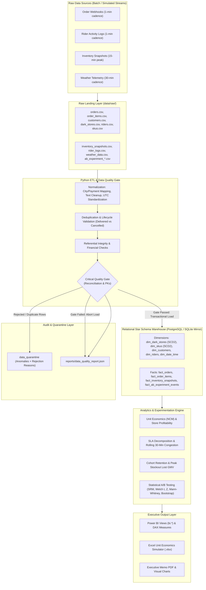

# QuickCommerceIQ — System Architecture

## 1. End-to-End Data Flow

## 2. Refresh Cadence Design (Batch-Configurable Locally)

| Stream / Layer | Target Production Cadence | Local Batch Implementation |
|---|---|---|
| Order Webhooks | Every 1 minute | `python/ingestion/etl_pipeline.py` (idempotent key dedup) |
| Rider Activity Events | Every 1 minute | `fact_rider_logs` batch load |
| Inventory Snapshots | Every 15 minutes | `fact_inventory_snapshots` (15-min peak 18:45–22:00 IST) |
| Weather Telemetry | Every 30 minutes | `fact_weather_observations` (30-min city slots) |
| Financial & SLA Analytics | Hourly | `python/analytics/engine.py` |
| Cohorts & A/B Readout | Daily | `python/experiments/ab_testing.py` |

## 3. Warehouse Design Choices
- **Timezone Standard:** All timestamps are normalized to UTC (`TIMESTAMPTZ`) on ingestion and converted to `Asia/Kolkata` (IST) for reporting and `dim_date_time` keys (`YYYYMMDDHH`).
- **SCD Type 2:** `dim_dark_stores` (rent tier & staffing revisions) and `dim_skus` (supplier cost & MRP changes) maintain `effective_from`, `effective_to`, and `is_current` attributes, while `fact_order_items` persists `historical_unit_price` and `historical_unit_cost` so historical profit never shifts retroactively.
- **Local Portability:** `python/db.py` connects to PostgreSQL (`psycopg` + SQLAlchemy) when configured/running via Docker Compose, and provides a schema-aligned local SQLite mirror (`data/processed/quickcommerce_warehouse.db`) so all analytics and tests run out of the box on Windows 11.
